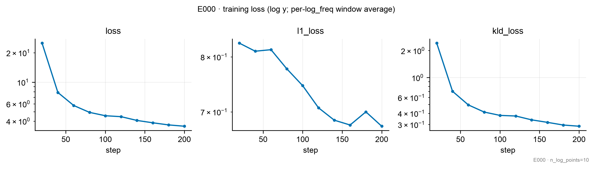
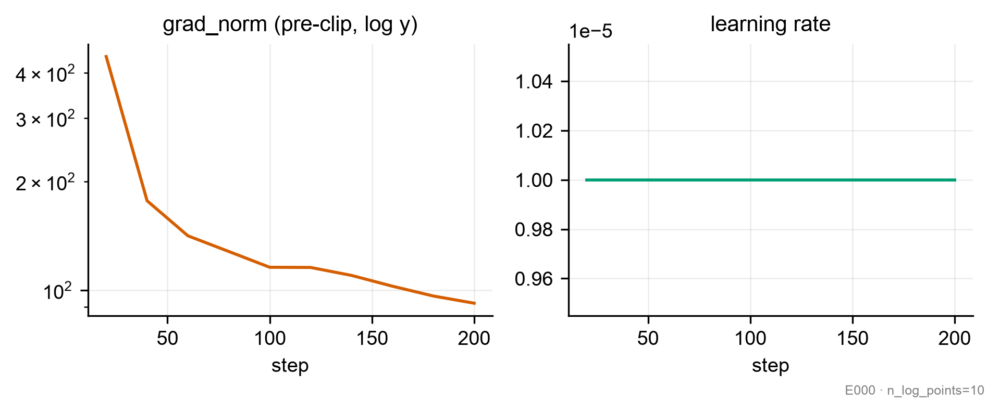
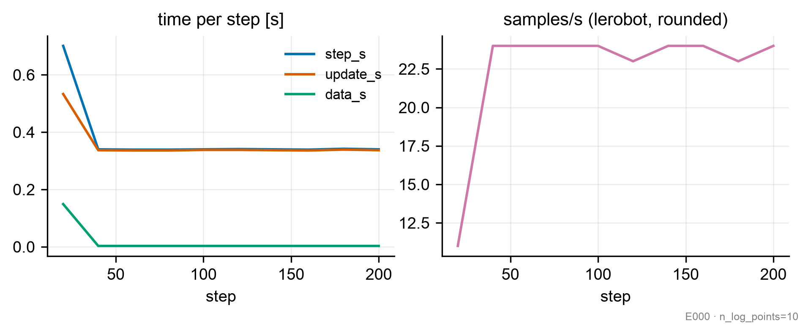

# E000 · ACT smoke test on cohab orange (2 cams, bs=8, 200 steps)
> TL;DR (EN): 200-step pipeline smoke test of lerobot 0.7.0 ACT on MPS. Training runs end-to-end with the pyav
> AV1 backend; steady-state step time is 0.340 ± 0.001 s (2.94 step/s, data loading 0.003 s → compute-bound),
> which projects 70k steps to ≈ 6.6 h. Loss fell 25.0 → 3.55. No checkpoint was saved (by design).
> Metrics were backfilled from the tmux scrollback (tail-25 of stdout), so only the last 25 lines exist.

| 항목 | 값 |
|---|---|
| 상태 / Status | done |
| 목적 / Purpose | lerobot 0.7.0 + MPS + pyav 학습 pipeline 동작 확인, 처리량 측정 (M1 사전 단계) |
| 데이터 | edge-inference/cohab-so101-pick-orange-dataset (100 ep, teleop, Isaac Sim 5.1) |
| 모델 | ACT 52M (51,597,190 params), cams=front+wrist, chunk=100, lerobot 기본값 |
| 하드웨어 | Mac Studio M4 Max 36GB, MPS fp32, num_workers=8 |
| 시간 | 2026-11-27 01:45:17 → 01:46:32 KST (학습 루프 약 75 s) |
| 커밋 | 해당 없음 (repo 생성 전에 실행) |
| Config | [configs/train/act_smoke.yaml](../../configs/train/act_smoke.yaml) (tmux 기록에서 복원) |

## 1. 설정 / Setup
- `--steps=200 --log_freq=20 --batch_size=8 --num_workers=8 --save_checkpoint=false --trackio.enable=false`
- 나머지는 lerobot 0.7.0 ACT 기본값 ([ADR-0003](../../docs/decisions/ADR-0003-lerobot070-investigation.md)), seed=1000 (기본)

## 2. 학습 dynamics / Training dynamics




| step | loss | l1_loss | kld_loss | grad_norm | step_s |
|---|---|---|---|---|---|
| 20 | 25.03 | 0.827 | 2.420 | 444.0 | 0.701 |
| 40 | 7.843 | 0.811 | 0.703 | 176.9 | 0.340 |
| 100 | 4.538 | 0.746 | 0.379 | 115.7 | 0.340 |
| 200 | 3.545 | 0.676 | 0.287 | 92.03 | 0.340 |

- 📏 출처: [metrics/train.jsonl](metrics/train.jsonl)
- 📏 steady-state (step ≥ 40, 9개 창): `step_s` 0.3400 ± 0.0010 s → 2.94 step/s, `update_s` 0.337 s, `data_s` 0.003 s
- 📏 로그 시각 기준 step 20→200: 61 s / 180 step = 0.339 s/step (위 값과 일치)
- 📏 첫 창(step ≤ 20)은 `data_s` 0.149, `step_s` 0.701로 warm-up 비용이 포함됨

## 3. 평가 / Evaluation
- 해당 없음 (200 step 스모크, checkpoint 저장 안 함)

## 4. 관찰 / Observations
- 📏 `data_s`(0.003) ≪ `update_s`(0.337) → **compute-bound**. num_workers 증설은 효과가 없을 것으로 봄
- 📏 70k step 예상 시간: $70000 \times 0.340\,\text{s} = 6.61\,\text{h}$ (checkpoint 저장 오버헤드 제외)
- 📏 마지막 창 기준 $\text{l1} + 10\cdot\text{kld} = 0.676 + 2.87 = 3.546 \approx$ `loss` 3.545 → kl_weight=10 구조 확인
- 📏 loss 감소의 대부분(25.0→7.8)은 kld 항이 줄어든 결과임 (2.42→0.70, ×10 가중). l1 감소는 0.83→0.68로 완만함
- 📏 `grad_norm` 92–444 vs `grad_clip_norm` 10 → 매 step clip이 걸림 (clip 전 값을 기록함)
- 🔮 bs 16/32에서 throughput(samples/s)이 선형으로 늘어날지는 미확인 → E003 후보

## 5. 한계 · 주의 / Caveats
- raw 로그가 없음. tmux scrollback에 남은 `| tail -25` 출력만 복원함 → 앞부분 INFO(`cfg.steps`, `dataset.num_frames` 등)는 없음
  - 그래서 `epoch_exact`가 없고, `wall_s`는 남아 있는 첫 INFO 줄(01:45:17) 기준임
- raw 복원본은 `logs/act_smoke_tmux.log` (git 제외). 개인 프롬프트 줄을 제거한 사본이 [tests/fixtures/lerobot_smoke_stdout.log](../../tests/fixtures/lerobot_smoke_stdout.log)에 있음
- output_dir `~/runs/act_smoke`는 현재 존재하지 않음 (`--save_checkpoint=false`)
- 200 step(1600 samples ≈ 데이터의 2.6%)이므로 학습 품질에 대한 결론은 낼 수 없음

## 6. 다음 단계 / Next
- E001 (70k)을 `run_train.py`로 실행함 → 실시간 JSONL 기록. 사용자 승인 필요

## 7. 재현 / Reproduce
```bash
caffeinate -is python scripts/run_train.py --exp E000 --config configs/train/act_smoke.yaml
# (원래 실행은 wrapper 없이 lerobot-train을 직접 호출함. backfill:)
python scripts/backfill_from_log.py --config configs/train/act_smoke.yaml --log logs/act_smoke_tmux.log
python scripts/make_figures.py E000_act_orange_smoke
```
