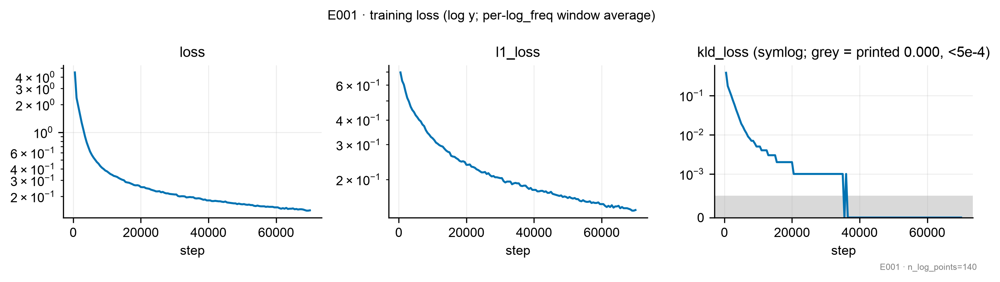
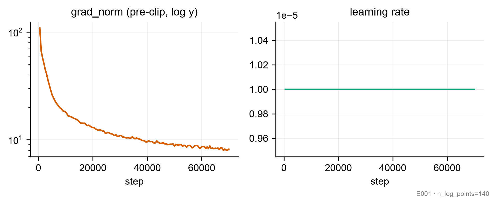
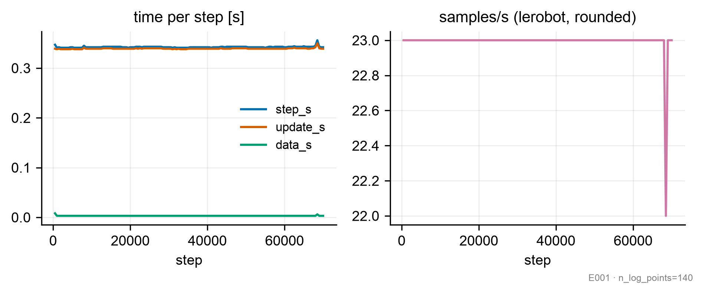
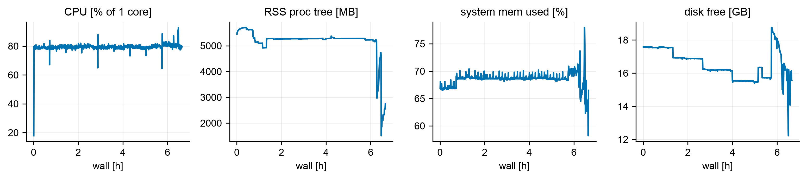

# E001 · ACT on cohab orange (2 cams, bs=8, 70k)
> TL;DR (EN): First full ACT run (front+wrist, bs=8, 70k steps ≈ 9.25 epochs, all 100 episodes) finished cleanly
> in 6.66 h on MPS (0.342 s/step, compute-bound, thermals nominal). Train L1 fell 0.695 → 0.140 (normalized
> action units) and was still decreasing ~11% per 14k-step block at the end. The KL term collapsed to < 5e-4
> after ~35.5k steps, i.e. the CVAE latent is effectively unused. No held-out split: all numbers are train-set.

| 항목 | 값 |
|---|---|
| 상태 / Status | done (exit 0) |
| 목적 / Purpose | Model A 후보 — sim pipeline 검증 (M1 사전 단계), 이후 sim rollout(RQ1의 $S_{\text{sim}}$) |
| 데이터 | edge-inference/cohab-so101-pick-orange-dataset (100 ep 전체, teleop, Isaac Sim 5.1) |
| 모델 | ACT 51.6M (추론 시 34.2M), cams=front+wrist, chunk=100, n_action_steps=100, kl_weight=10, lr=1e-5 고정 |
| 하드웨어 | Mac Studio M4 Max 36GB, MPS fp32 |
| 시간 | 2026-11-27 02:14:37 → 08:54:18 KST, wall 6.662 h |
| 커밋 | `28bfe37` (manifest.json) |
| Config | [configs/train/act_orange_2cam_b8.yaml](../../configs/train/act_orange_2cam_b8.yaml) · lerobot 전체 config는 `runs/act_orange_2cam_b8/checkpoints/070000/pretrained_model/train_config.json` (git 제외) |

## 1. 설정 / Setup
```
--dataset.repo_id=edge-inference/cohab-so101-pick-orange-dataset
--dataset.root=$HOME/datasets/cohab_orange
--dataset.video_backend=pyav
--policy.type=act --policy.device=mps --policy.push_to_hub=false
--batch_size=8 --num_workers=8 --steps=70000 --log_freq=500 --save_freq=14000
--trackio.enable=false
--output_dir=runs/act_orange_2cam_b8 --job_name=act_orange_2cam_b8
```
- seed는 지정하지 않았으므로 lerobot 기본값 1000을 씀
- checkpoint 5개 (14k/28k/42k/56k/70k) × 590.86 MB (📏) = 2.95 GB
- 📏 스모크 참고값 ([E000](../E000_act_orange_smoke/README.md)): 2.94 step/s, `data_s` 0.003, `updt_s` 0.337, loss 25.0→3.55 (200 step)

## 2. 학습 dynamics / Training dynamics





| step | loss | l1_loss | kld_loss | grad_norm |
|---|---|---|---|---|
| 500 | 4.490 | 0.695 | 0.379 | 109.1 |
| 5k | 0.616 | 0.422 | 0.019 | 26.20 |
| 14k | 0.310 | 0.280 | 0.003 | 15.40 |
| 28k | 0.216 | 0.208 | 0.001 | 10.92 |
| 42k | 0.179 | 0.175 | 0.000 | 9.52 |
| 56k | 0.156 | 0.154 | 0.000 | 8.71 |
| 70k | 0.141 | 0.140 | 0.000 | 8.18 |

- 📏 출처: [metrics/train.jsonl](metrics/train.jsonl) (140줄, `step_exact` 140/140, parse_error 0)
- 📏 14k 구간별 l1 평균: 0.403 → 0.236 → 0.189 → 0.164 → 0.146. 마지막 구간에서도 직전 대비 −10.6%로 계속 감소함
- 📏 kld: 35.5k step부터 출력값이 `0.000`임 (lerobot은 소수 3자리까지 출력 → $<5\times10^{-4}$). 140개 창 중 69개
- 📏 grad_norm: 38k step부터 10 미만으로 내려감 → 그 이후 grad clip(10)은 대부분 걸리지 않음 (전체 창의 46.4%가 10 미만)
- 📏 처리량: `step_s` 평균 0.3424 s (최대 0.356), `data_s` 0.003 → compute-bound. E000 추정치(6.6 h)와 실제 wall(6.662 h)이 거의 일치함
- 📏 checkpoint: 5개 × 590.86 MB = 2.95 GB. 저장 시각 03:37 / 04:57 / 06:17 / 07:36 / 08:54 ([metrics/events.jsonl](metrics/events.jsonl))
- 📏 시스템 ([metrics/system.jsonl](metrics/system.jsonl), 798 샘플): RSS 중앙값 5.27 GB (최대 5.71 GB), 시스템 메모리 최대 78.0%, swap 387 MB로 변화 없음, thermal은 내내 nominal, 디스크 여유 최저 12.22 GB

## 3. 평가 / Evaluation
- offline action L1 (`offline_eval.py`): **미구현**. 구현하더라도 E001은 held-out이 없으므로 train-set 수치임
- sim rollout pilot: 📏 [`metrics/rollouts_sim.jsonl`](metrics/rollouts_sim.jsonl) (sweep 1, 2026-11-27 21:15–02:10, HANDS run `20261127-211555_E001_ckpt_sweep`, git 7881bc1)
  - LeIsaac 기본 reset randomization, seed 1000 고정 (조건 간 같은 20개 배치), warmup 120 step, env timeout 60 s
  - 이 record의 `success`는 **LeIsaac `task_done`** (rest 자세 조건 포함). `all3_end` = 마지막 확인 시점 오렌지 3개 in-box (rest·release 미확인)

| 조건 | success (LeIsaac) | all3_end | max_placed 평균 [boot 95%] | 0/1/2/3개 |
|---|---|---|---|---|
| 28k h100 | 1/20 [0.01, 0.24] | 5/20 [0.11, 0.47] | 1.60 [1.15, 2.10] | 5/3/7/5 |
| 42k h100 | 0/20 [0.00, 0.16] | 4/20 [0.08, 0.42] | 1.50 [1.05, 1.95] | 4/6/6/4 |
| 56k h100 | 3/20 [0.05, 0.36] | 5/20 [0.11, 0.47] | 1.70 [1.25, 2.15] | 3/5/7/5 |
| 70k h100 | 3/20 [0.05, 0.36] | 8/20 [0.22, 0.61] | 1.90 [1.35, 2.40] | 5/0/7/8 |
| 70k h50 | 4/20 [0.08, 0.42] | 12/20 [0.39, 0.78] | 2.45 [2.05, 2.75] | 1/1/6/12 |
| 70k h25 | 4/20 [0.08, 0.42] | 12/20 [0.39, 0.78] | 2.55 [2.30, 2.80] | 0/1/7/12 |

  - paired (vs 70k h100): h25 max_placed +0.65 [+0.20, +1.15] (sign p = 0.065), 28k −0.30 [−0.80, +0.20]. step 효과는 불명확, 재질의 주기 효과는 경계선 수준
  - 31/120 ep가 오렌지 3개를 배치·유지했지만 rest 조건으로 실패 → [ADR-0004](../../docs/decisions/ADR-0004-sim-success-protocol.md)에서 success 정의 변경
  - 재현: `python3 scripts/analyze_sim_rollouts.py experiments/E001_act_orange_2cam_b8/metrics/rollouts_sim.jsonl --ref ck70k_h100`
- sim rollout (9-grid × 50, protocol): 미실행

## 4. 관찰 / Observations
- 📏 train L1은 70k에서도 수렴하지 않았음. 다만 held-out이 없어서 더 학습하는 것이 일반화에 도움이 되는지는 알 수 없음
- 📏 KL collapse: kld가 $<5\times10^{-4}$으로 떨어짐 → CVAE latent $z$가 사실상 정보를 담지 않음
  - 🔮 추론 시에는 어차피 $z=0$을 쓰므로 deterministic 정책으로서 큰 문제는 아닐 수 있음
  - 🔮 다만 demo의 multimodality(같은 상황에서 다른 행동)를 latent로 구분하지 못한다는 뜻임. 정책은 평균적인 행동을 내게 됨
- 🔮 L1은 normalized action 단위임 (MEAN_STD). action std 평균이 약 30.7이므로, 0.140은 대략 4 단위(−100..100 스케일) 수준의 평균 오차에 해당함. joint별로는 다를 것임 (offline_eval로 확인 필요)
- 📏 마지막 31.5k step은 grad clip이 대부분 걸리지 않았음 → 학습 후반은 lr 1e-5의 순수 AdamW 업데이트임

## 5. 한계 · 주의 / Caveats
- `manifest.json`의 `git_dirty: true`는 wrapper 버그 때문임. `env/pip_freeze.txt`를 먼저 쓴 뒤 `git status`를 실행해서 생긴 값임. 실행 직전에 `git status --short`가 0줄이었음을 확인함 (커밋 `28bfe37`). 코드는 이후 수정함
- held-out split이 없음 → 과적합 여부를 판단할 수 없음. 모든 수치는 train-set임
- loss와 grad_norm은 log_freq(500) 창 평균임. 개별 step 값은 없음
- kld는 lerobot 출력 해상도(소수 3자리) 때문에 $<5\times10^{-4}$ 영역을 구분할 수 없음
- long-tail episode(ep33: 2564 frames, ep40: 1912 frames)가 포함됨 ([03_data](../../docs/03_data.md))
- image augmentation이 꺼져 있었음 (`image_transforms.enable=False`)

## 6. 다음 단계 / Next
1. `offline_eval.py` 구현 → 각 checkpoint의 joint별 action L1 (split=train으로 표기)
2. 마지막 checkpoint를 HANDS `~/policies/E001/`로 전송 (사용자 승인 후, `ssh hands` 확인 필요)
3. LeIsaac에서 9-grid sim rollout 계획 수립 → $S_{\text{sim}}$ (RQ1)
4. E002 (wrist-only + held-out 90/10)
- 계획 변경 조건
  - sim rollout 성공률이 매우 낮으면 (예: CI 상한 < 0.2) checkpoint별(28k/42k/56k/70k) 비교를 먼저 함
  - E002의 held-out L1이 train L1보다 크게 높으면 과적합으로 보고 step 수를 줄임

## 7. 재현 / Reproduce
```bash
caffeinate -is python scripts/run_train.py --exp E001 --config configs/train/act_orange_2cam_b8.yaml
python scripts/make_figures.py E001_act_orange_2cam_b8
```

## Open questions / 미해결
- KL collapse가 sim rollout 성능에 영향을 주는지 (kl_weight 조정 실험이 필요한지)
- 70k 이후 추가 학습이 sim 성공률을 올리는지 (train L1은 계속 감소 중)
- front 카메라를 실제 로봇에 sim과 같은 위치로 둘 수 없다면 E001은 실제 로봇 평가(RQ1)에 쓸 수 없음
